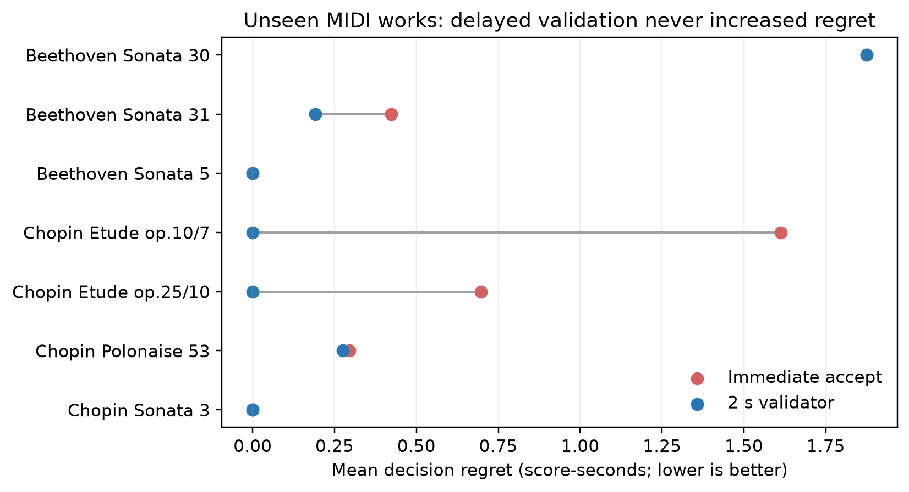
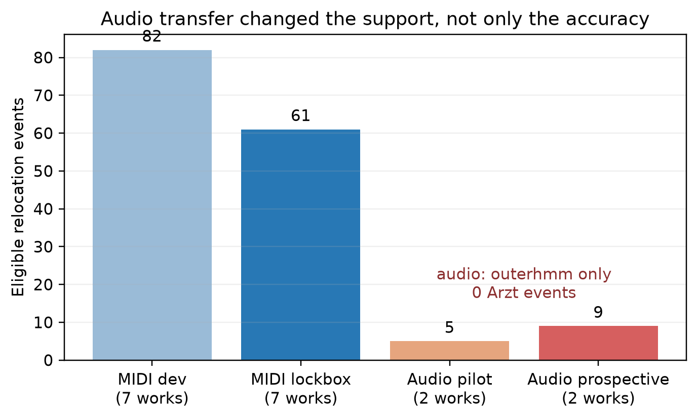
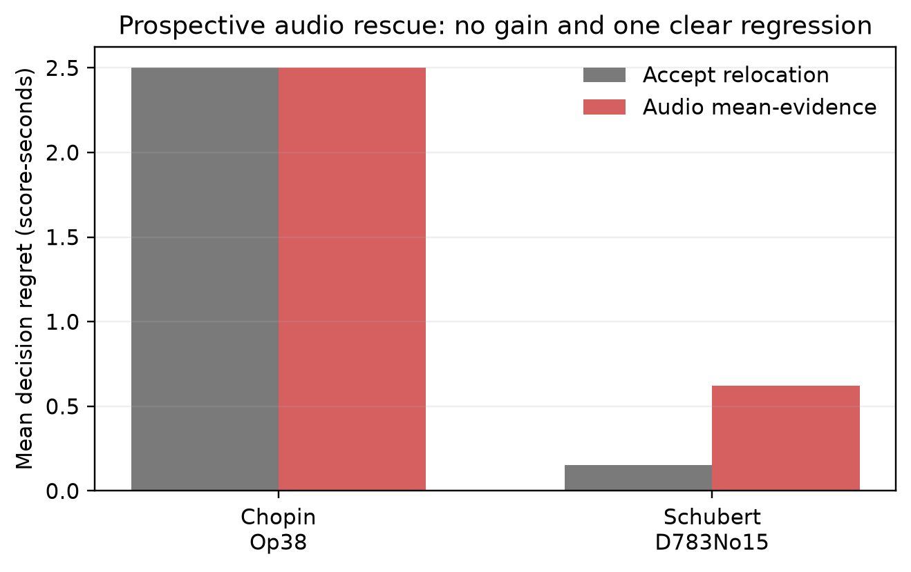

# From Score Ambiguity to Decision Utility: A Frozen Cross-Domain Audit of Post-hoc Relocation Validation

**Anonymous authors**  
Draft date: 24 September 2026

## Abstract

Score following research commonly reports localization accuracy, although an interactive system must eventually decide whether to expose a sudden relocation to its user. We study this decision boundary by tracing a sequence of increasingly operational hypotheses. Static score ambiguity was weakly associated with online error in prior analyses, and two seconds of future context improved retrospective localization, but ambiguity did not identify where waiting would help. We therefore evaluate a post-hoc accept/hold wrapper triggered by score-position jumps of at least two score-seconds. The wrapper observes two additional seconds of tracker stability, cross-tracker agreement, and performance-to-candidate chroma evidence, while leaving the underlying tracker unchanged. On a frozen lockbox of eight unseen ASAP MIDI performances, the wrapper reduced work-equal decision regret from 0.700 to 0.334 score-seconds (bootstrap 95% interval for improvement [0.033, 0.824]) and increased action accuracy from 71.0% to 83.4%. This result did not transfer to real audio. Across 40 Vienna 4x22 performances, only 14 eligible events occurred, all from one of two trackers and only two of four works. In a prospectively fixed 32-performance subset, a parameter-free audio evidence rule worsened work-equal regret by 0.235 score-seconds (95% interval [-0.470, 0.000]) with 60% hold precision. Prior work already establishes delayed decisions and multi-hypothesis recovery; our contribution is therefore not a new delayed-decision principle. Instead, we show that a decision rule can pass a symbolic lockbox while failing both trigger coverage and decision quality in audio, and argue that coverage must be audited before relocation validation is treated as a practical safety mechanism.

## 1. Introduction

Real-time score followers support automatic accompaniment, page turning, and interactive performance systems. Their usual outputs are continuous score-position estimates, but failures are often discontinuous: a follower may suddenly jump to another plausible location. At that moment a user-facing system must choose an action. It can immediately expose the new position, or temporarily preserve the previous display while accumulating evidence. The loss from a wrong action depends not only on frame-level alignment accuracy, but also on the alternative action that was available.

Our earlier experiments began with *score ambiguity*: the similarity of the current score context to another location. On the healthy subset of the ASAP analysis, local ambiguity had a positive but modest association with online error (combined Spearman correlation 0.2063; 27 of 40 works passed the predefined health checks). In a matched Bayesian follower, two seconds of fixed-lag context improved retrospective localization by 5.72 percentage points for chroma and 4.68 points for pitch observations. Crucially, however, ambiguity did not identify the locations where that context produced the largest gain. Multiple attempts to turn the ambiguity map into a model selector, anchor policy, or competing-candidate feature also failed against stronger state-based baselines.

This left a practical gap: the experiments established that context can help on average, but not when a system should wait or what it should do after waiting. We narrow the problem to large relocation events and replace a static score property with event-conditioned evidence. Our evaluation asks:

1. Can a frozen post-hoc wrapper reduce the regret of accept/hold decisions after large position jumps on unseen symbolic performances?
2. Does the same event definition, model, and evidence boundary remain applicable to real audio trackers?
3. If transfer fails, is the failure caused only by the learned symbolic model, or also by event coverage and candidate evidence?

The central result is deliberately asymmetric. The symbolic lockbox passes, while both frozen and simplified audio transfer tests fail. The negative result is operationally important because the audio domain changes which tracker and repertoire generate the trigger at all.

## 2. Related work and novelty boundary

Online time warping established efficient continuous alignment for live performance [@dixon2005]. Robust recovery from arbitrary structural deviations has also been studied directly. Arzt and Widmer's any-time tracker maintains multiple high-level hypotheses, evaluates candidate locations with detailed matchers, and may accept, reject, or postpone a candidate [@arzt2010]. Fox and Quinn inject bottom-up location hypotheses into a particle-filter score follower [@fox2007]. Yamamoto et al. use a delayed-decision Viterbi procedure, exploiting future observations to determine a past score position while anticipating the present [@yamamoto2013]. Nakamura et al. develop efficient HMMs for performance errors and arbitrary repeats or skips [@nakamura2016].

These precedents rule out claims that waiting for evidence, maintaining multiple candidates, or accepting/holding a relocation is itself novel. Matchmaker now provides unified reference implementations and systematic comparisons for real-time piano score following [@park2025]. We use its OLTWArzt and outer-product-HMM-style trackers as fixed upstream systems.

Our narrower contribution is an evaluation design: a model-agnostic, post-hoc action wrapper; an explicit capped decision-regret endpoint; a frozen symbolic lockbox; and a prospective audit showing that audio transfer can fail through trigger coverage as well as classification error. We also separate static score ambiguity, which supplies an evaluation condition, from observation-dependent evidence between the two candidates created by a realized jump.

## 3. From score ambiguity to a dynamic decision

### 3.1 Static and dynamic ambiguity

Let \(S_j\) denote a fixed score-context representation beginning at score position \(j\), and let \(\kappa\) be cosine similarity. The original score-only ambiguity at position \(j\) is

\[
A_{\mathrm{score}}(j)=\max_{k\in\mathcal R(j)}\kappa(S_j,S_k),
\]

where \(\mathcal R(j)\) excludes the local neighborhood of \(j\). This quantity states that a similar rival exists, but it does not state that the current tracker assigns probability to that rival or that the incoming performance fails to distinguish the two.

After a realized relocation, the relevant candidate set is no longer every score position but the event-specific pair \(\{o,d\}\), consisting of the pre-jump origin and post-jump destination. For predictive candidate masses \(q_t(o),q_t(d)\) and observation costs \(C_t(o),C_t(d)\), the Bayesian update obeys the exact odds decomposition

\[
\log\frac{p_t(d)}{p_t(o)}
=\log\frac{q_t(d)}{q_t(o)}
-\beta\left[C_t(d)-C_t(o)\right].
\]

The first term contains the tracker dynamics and accumulated state; the second is the observation evidence that separates the score candidates. We therefore define normalized dynamic ambiguity for the realized pair as

\[
A_{\mathrm{dyn}}(e,t)
=\frac{H\!\left(\tilde p_t(o),\tilde p_t(d)\right)}{\log 2},
\qquad
\tilde p_t(j)=\frac{p_t(j)}{p_t(o)+p_t(d)},
\]

where \(e=(o,d,t_0)\). It is near one when the candidates remain equiprobable and near zero when the accumulated state and observations resolve the pair. This is a conditional extension of score ambiguity, not a deterministic transformation of \(A_{\mathrm{score}}\): similar score contexts make a rival structurally available, whereas tracker state and realized observations determine whether that rival is dynamically unresolved.

The complete event-level ambiguity object is therefore two-dimensional:

\[
\mathcal A(e,t)=\left(
\underbrace{\kappa(S_o,S_d)}_{\text{structural confusability}},
\underbrace{A_{\mathrm{dyn}}(e,t)}_{\text{observation-conditioned unresolvedness}}
\right).
\]

Keeping the two components separate is essential: multiplying or otherwise collapsing them into a new scalar would introduce an unvalidated weighting rule. A highly similar pair can already be resolved by the performance, while a less similar pair can remain uncertain because of tracker state or weak observations.

For the model-agnostic wrapper, calibrated candidate posterior masses are not available from both trackers. We therefore use an operational evidence margin

\[
m_e(t_1)=\kappa(\bar X_{t_0:t_1},\bar S_d)
-\kappa(\bar X_{t_0:t_1},\bar S_o),
\]

together with tracker stability and cross-tracker agreement. The prospective parameter-free audio rule accepts if \(m_e(t_1)\geq0\). The learned symbolic wrapper uses the same two support values and their margin as three of its delayed features; it does not claim that the ridge output is a calibrated posterior or that \(1-|m_e|\) is a universal ambiguity scale.

This formalization connects the earlier results. P1 concerns \(A_{\mathrm{score}}\); P2 shows that extending the observation interval can change a past-position estimate; and semi-P3 establishes exactly that flattening \(C_t(d)-C_t(o)\) to zero removes positional observation log-odds. The relocation experiment then tests whether the realized reduction in candidate uncertainty has enough decision value to justify accept rather than hold. Our negative static-policy results show that \(A_{\mathrm{dyn}}\neq f(A_{\mathrm{score}})\) for any validated score-only rule in the present data.

### 3.2 Action and loss

Let a tracker emit a relocation at performance time \(t_0\) when the absolute change between consecutive score-position outputs is at least two score-seconds. Relocations within a two-second burst are merged by retaining the largest jump. At \(t_1=t_0+2\) seconds, the wrapper chooses between:

- **accept:** expose the tracker's latest position at \(t_1\);
- **hold:** preserve the score position immediately before the jump as the user-facing output while the underlying tracker continues running.

For ground-truth score position \(g(t_1)\), action loss is

\[
L(a)=\min\left(\left|s_a(t_1)-g(t_1)\right|,5\right),
\]

measured in score-seconds. Event regret is \(L(a)-\min_{a'\in\{accept,hold\}}L(a')\). The five-second cap prevents a few extreme relocations from dominating work-level comparisons.

The immediate model uses only information available at \(t_0\): jump magnitude and direction, recent score progress, and the other tracker's proximity to the origin and destination. The delayed model adds tracker stability through \(t_1\), changes in cross-tracker agreement, and chroma support of the observed performance for score windows beginning at the origin and destination. All performance features are causal through \(t_1\); future ground truth is used only for evaluation.

On development works, both models use train-work-equal standardization and ridge regression with \(\alpha=1\). The target is \(L(hold)-L(accept)\), with zero as the fixed action threshold. The resulting model, delay, trigger, features, and threshold were frozen before the lockbox was opened (model SHA-256 `233e85f...a422ff`).

## 4. Experimental protocol

### 4.1 Symbolic development and lockbox

The MIDI experiments use ASAP aligned performances [@foscarin2020]. Development contained 82 eligible events from seven works and both trackers. Leave-one-work-out evaluation reduced work-equal regret from 0.248 to 0.116, but the original gate required strict improvement in at least five of seven works. Only three improved; four were tied at zero baseline regret. We retained the official development verdict as **fail** rather than rewriting the gate.

Before opening the preserved cohort, we wrote a new floor-aware confirmatory contract. It required at least 40 events, six works, both trackers, a positive work-bootstrap lower bound against both baselines, improvement on at least 60% of actionable works, non-inferiority on floor works, and no material work-level regression. The lockbox comprised eight performances from eight unused works, with no development overlap in work family or performer. No parameter was refit.

### 4.2 Frozen audio transfer

We next applied the unchanged event definition and frozen model to eight Vienna 4x22 audio performances: four works and performers p01 and p12 [@goebl1999]. Matchmaker was fixed at commit `40fd6e7`. The implementation gate checked finite monotone paths, score-domain validity, causal-prefix identity, and strictly monotone ground-truth anchors.

Only five eligible events were observed. Because this was insufficient to distinguish model failure from evidence mismatch, we used those opened events only to compare three exploratory, parameter-free candidate measures: mean chroma, an ordered diagonal score, and local DTW. Mean chroma was best on the five opened events (four correct), so it was frozen before a prospective follow-up.

### 4.3 Prospective audio evidence test

The prospective set comprised 32 previously unused performances: all four Vienna works crossed with performers p02, p05, p08, p11, p14, p17, p20, and p22. For each event, the rule compares the mean chroma of audio from \([t_0,t_1]\) with two-second score-chroma windows beginning at the origin and destination. It accepts when destination similarity is at least origin similarity and holds otherwise. No margin or tuned threshold is used.

The predeclared gate required at least 20 events over 12 performances and three works, events from both trackers, positive work-equal regret improvement with a positive bootstrap lower bound, no work worsened by more than 0.05 score-seconds, at least five holds, and hold precision of at least 0.8.

### 4.4 Auditing and aggregation

All principal metrics are first averaged within work and then equally across works. Bootstrap intervals resample works 20,000 times with seed 20260924. Separate audit scripts reimplement the frozen predictor or decision rule without importing experiment code; they verify event files, source and input hashes, metrics, gates, and causal-prefix tests. A top-level package audit reproduces the exact paper success/failure boundary.

## 5. Results

### 5.1 The symbolic lockbox passed

The lockbox produced 61 events from seven of eight works and both trackers. Work-equal regret fell from 0.700 for immediate acceptance to 0.334 for the delayed wrapper, an improvement of 0.366 score-seconds with a work-bootstrap 95% interval of [0.033, 0.824]. Work-equal action accuracy increased from 71.0% to 83.4%.

Five works were actionable, four improved, and one tied; two floor works remained at zero regret. No work worsened by more than 0.05 score-seconds. The model held five events, all of which were oracle holds, while the oracle preferred hold for nine events. Thus hold precision was 100% and recall 55.6% on this small sample. A post-hoc exact one-sided sign-flip test over the four nonzero improvements yielded \(p=0.0625\), so the positive bootstrap interval should not be read as large-sample certainty.

### 5.2 Frozen audio transfer failed by support and action

The eight-performance audio pilot passed all implementation checks but yielded only five events over three performances and two works. Every event came from `outerhmm`; `arzt` generated none. The frozen delayed model accepted all five relocations, including two oracle holds, and therefore matched the always-accept baseline. Every predeclared effectiveness gate failed except non-worsening.

Across the subsequent 32 performances, only nine events occurred over seven performances and two works. Again, all came from `outerhmm`; none came from `arzt`. Combining the two phases for descriptive coverage only gives 14 events across 40 performances, still restricted to the same tracker and the same two works.

### 5.3 The prospective audio rescue also failed

The mean-evidence rule held five of nine events, while the oracle preferred hold for four. Three holds were correct, giving 60% hold precision rather than the required 80%. Work-equal improvement over accepting every relocation was -0.235 score-seconds, with bootstrap interval [-0.470, 0.000]. On Chopin Op. 38 both rules had regret 2.5; on Schubert D.783 No. 15 regret increased from 0.153 to 0.623. All effectiveness and support gates failed.

The exploratory ordering-aware scores did not offer an overlooked rescue: on the already opened five events, ordered diagonal matching and local DTW each classified only three correctly and never held. Those comparisons are diagnostic, not confirmatory.

## 6. Discussion

The experiments answer a more useful question than whether the symbolic model “generalizes.” Transfer altered the support of the intervention. A wrapper that triggers on large score-position jumps cannot be evaluated as a generic safety layer when one upstream tracker never produces the event and half the repertoire contributes none. Conditional accuracy on a handful of selected events would hide that applicability failure.

The results also clarify the role of ambiguity. Static score self-similarity was useful for organizing failure analysis, but it was not a reliable operational trigger. The useful symbolic features were dynamic: whether the relocated tracker stabilized, whether trackers converged, and which candidate the observed performance supported. Yet even this observation-dependent boundary was domain-specific. Mean chroma created false holds in audio, showing that “wait for more evidence” is incomplete without specifying how evidence separates the candidates.

For practitioners, the defensible recommendation is conditional. If a symbolic-input follower emits a relocation of this defined type, temporarily validating it may reduce display regret. This recommendation does not extend to microphone audio, to unseen trackers, or to arbitrary repeats and skips. In audio, developers should first measure trigger exposure by tracker and repertoire, then validate candidate evidence prospectively. A zero-event tracker is not evidence of perfect safety; it makes this particular wrapper inapplicable.

For research evaluation, we recommend reporting four quantities together: trigger exposure, number of independent works and performances, action regret relative to an explicit baseline, and false-hold precision. Frame accuracy alone cannot reveal whether a recovery wrapper acts rarely, concentrates on one tracker, or withholds correct relocations.

## 7. Limitations

The symbolic lockbox shares the ASAP MIDI and annotation pipeline with development; it is work- and performer-disjoint but not corpus-independent. Only seven lockbox works generated events, and the exact sign-flip result over nonzero work improvements did not cross 0.05. The audio validation uses four Vienna works, so its 32-performance phase tests new performers rather than new repertoire. Both trackers are specific Matchmaker implementations and default configurations. The `hold` action freezes only the displayed position; it does not rewind tracker state. Finally, the study simulates streaming from files and does not measure microphone, device, or user-perceived latency.

## 8. Conclusion

A frozen two-second validator reduced accept/hold decision regret on unseen symbolic performances, but its trigger distribution and decision boundary did not transfer to real audio. A simpler prospective audio rule also failed. Because delayed decision and multi-hypothesis recovery are established ideas, the contribution is not a new score-following algorithm. The reusable finding is methodological: post-hoc recovery mechanisms must be evaluated at the level of actions and must audit whether their triggering events exist across trackers, works, and domains. Static ambiguity may define a stress condition, but observation-dependent evidence and domain-specific coverage determine whether waiting is useful.

## Reproducibility note

The frozen model, protocols, event-level results, independent audits, and asset-generation scripts are included in the repository. Run `python scripts/audit_relocation_research_package.py` to reproduce the paper-level verdict, and `python scripts/build_relocation_paper_assets.py` to regenerate figures and the summary table. The audit intentionally does not import experiment implementation code.

## References

The citation records are in `references.bib`.
